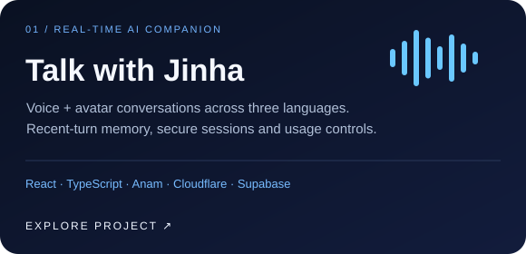
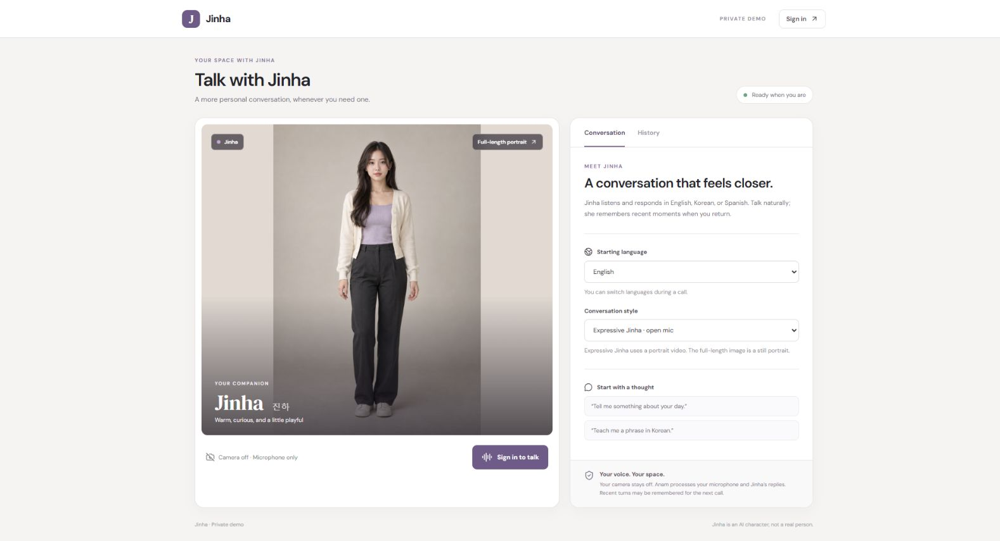

# Jinha — Real-time AI Companion

A voice-first AI companion application with an expressive avatar, multilingual conversations and memory of recent turns. Built by **[Jevin Thakar](https://github.com/jevin042)** with React, TypeScript, Anam, Cloudflare Workers and Supabase.

**[View demo interface ↗](https://jinha-companion.jinha-companion.workers.dev/)** · **[Architecture](docs/architecture.md)** · **[Setup guide](docs/setup.md)**

The hosted demo is invite-only. Viewing the interface is public; starting a conversation requires an invited account, enabled calls and available provider credits. Publishing this repository does not open the hosted demo to new callers.



## Features

- Live voice and portrait-avatar conversations through Anam, with Tavus alternatives.
- English, Korean and Spanish starting languages, with language switching during conversation.
- A fictional AI character with an emotion-aware conversation prompt.
- Per-user memory of recent expressive conversation turns, restored as context on a later call.
- Supabase authentication and a server-side invited-email allowlist.
- Call duration caps, global and per-user budgets, and one active call at a time.
- A responsive desktop/mobile interface, microphone controls, captions and usage history.
- Camera stays off. The full-length portrait is a still image, distinct from the live portrait video.

Emotion behavior is guided by prompts and provider capabilities; this repository does not claim a measured emotion-recognition accuracy. History displays usage rather than a full transcript. Anam is a third-party service, not a model owned or trained by this project.

## Stack

| Layer | Technology |
| :--- | :--- |
| Interface | React, TypeScript, Vite, Lucide |
| Live avatar | Anam JavaScript SDK; Tavus/Daily alternatives |
| Authentication | Supabase Auth |
| Backend | Cloudflare Workers |
| Memory and call coordination | Cloudflare Durable Objects |
| Speech and text fallback | Cloudflare Workers AI |

## Run locally

```bash
npm ci
cp .dev.vars.example .dev.vars
# Fill .dev.vars with your own provider credentials and invited email.
npm run build
npm run preview
```

On Windows PowerShell, use `Copy-Item .dev.vars.example .dev.vars`. Wrangler serves the built frontend and Worker together. `npm run dev` runs only the Vite UI; use `npm run preview` for authentication and live conversation APIs.

```bash
npm run typecheck
npm test
npm run build
```

Provider identifiers and credentials in this public copy are blank or placeholders. Calls default to disabled in `wrangler.jsonc`; configure your own services before enabling them. See the [setup guide](docs/setup.md) for production secrets and deployment.

## Repository layout

```text
src/                 React UI, audio controls and live-call lifecycle
worker/index.ts      Authenticated APIs and Durable Object coordinator
worker/policy.ts     Character prompt, languages and budget rules
tests/               Policy, security, emotion and open-mic checks
scripts/tavus.mjs    Optional Tavus inspection/configuration helper
public/              Static portrait and response headers
docs/                Architecture, setup and interface preview
```

## Dependencies and privacy

Anam/Tavus, Cloudflare and Supabase require your own accounts and may incur usage charges. Audio and conversation text may be processed by providers. Recent turns are stored per user for return-call context; do not use this demo for sensitive personal information. Application time counters are safeguards, not authoritative provider billing balances.

The code and original project assets are presented as a portfolio project. No open-source licence is granted by this repository. Third-party SDKs and services retain their own licences and terms.
