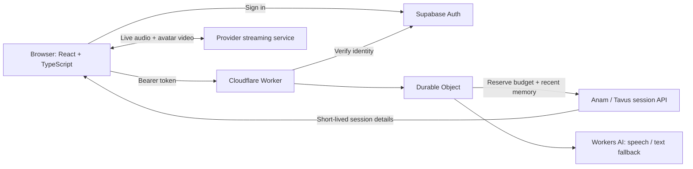

# Architecture

The browser fetches public configuration, signs in with Supabase and passes its access token to the Worker. The Worker validates identity and the invited-email allowlist. The Durable Object coordinates one active call, reserves usage, tracks per-user time and stores recent expressive turns. The backend creates provider sessions; provider API keys stay server-side.

The browser streams through the provider SDK. Call termination and periodic state refresh reconcile the UI with the coordinator. Recent turns may be supplied to the next expressive call. The History tab shows call usage, not a transcript.

## Boundaries

- Session tokens are temporary credentials. Never put API keys in frontend code.
- Supabase service-role keys must not be used as the browser publishable key.
- Trial budgets and call caps do not replace provider billing or production monitoring.
- The user camera is disabled. The full-length image is a still portrait.
- This is a hosted-avatar integration; Anam's model and proprietary systems are not part of the source code.
